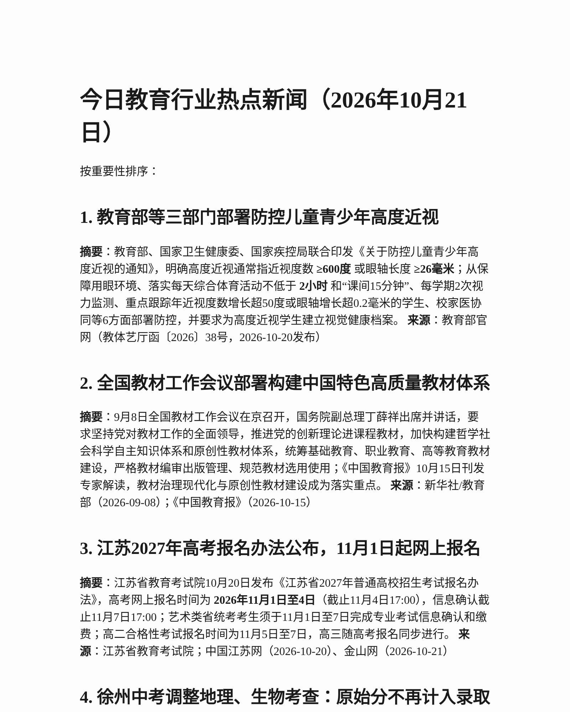

# 教育行业热点日报

每日整理教育政策、升学考试、教材教辅与“AI+教育”动态的 Markdown 日报仓库。内容以公开网络来源为准，逐条标注发布时间与出处。

## 日报索引

| 日期 | 日报 | 页面截图 |
| --- | --- | --- |
| 2026-10-16 | [教育行业热点新闻](education-news-2026-10-16.md) | - |
| 2026-10-19 | [教育行业热点新闻](education-news-2026-10-19.md) | [查看](.screenshots/6ad568b625900f2a4435ac7c.png) |
| 2026-10-21 | [教育行业热点新闻](education-news-2026-10-21.md) | [查看](.screenshots/6ad8009fef7bc9610fdbb154.png) |
| 2026-10-23 | [教育行业热点新闻](education-news-2026-10-23.md) | - |

> 截图仅用于展示日报排版，具体内容以 Markdown 文件为准。

## 收录范围

- **国家级政策**：党中央、国务院、教育部及其他部委发布的重要通知、政策和部署。
- **省级动态**：重点跟踪江苏省高考、中考政策及各地市考试招生改革。
- **教材与教辅**：教材修订替换、教材建设、教辅材料选用与行业产品动态。
- **其他相关**：互联网+教育、人工智能赋能教育、教育硬件与在线教育行业变化。

## 时效约定

日报按以下层级标注，避免把旧闻混入“今日”：

- **当日要闻**：发布时间为当日或前一工作日的重要新闻。
- **近期**：近两周内发布、仍需持续关注的政策或行业信息。
- **背景**：更早发生、用于补充政策脉络或行业趋势的材料，均注明原始发布时间。

自 2026-10-21 起，每条新闻均包含标题、一句话摘要、时效、来源与发布时间；更早日报的原始发布时间见各条来源。全部内容不编造、不替代官方原文。

## 文件与分支约定

- 日报文件名：`education-news-YYYY-MM-DD.md`。
- 所有日报统一提交到 `2026` 分支，不再按日期新建分支。
- 提交信息风格：`docs: 补充教育行业热点新闻报告 (YYYY-MM-DD)`。

## 数据来源与免责声明

内容整理自教育部、地方政府、教育考试院、主流媒体及公开行业报告。受信息发布节奏影响，部分条目可能存在后续更新；如发现事实或来源标注错误，欢迎提交 Issue 或 Pull Request 指正。本仓库仅用于信息整理，不构成政策解读、法律或投资建议。

## License

本项目采用 [MIT License](LICENSE)。
